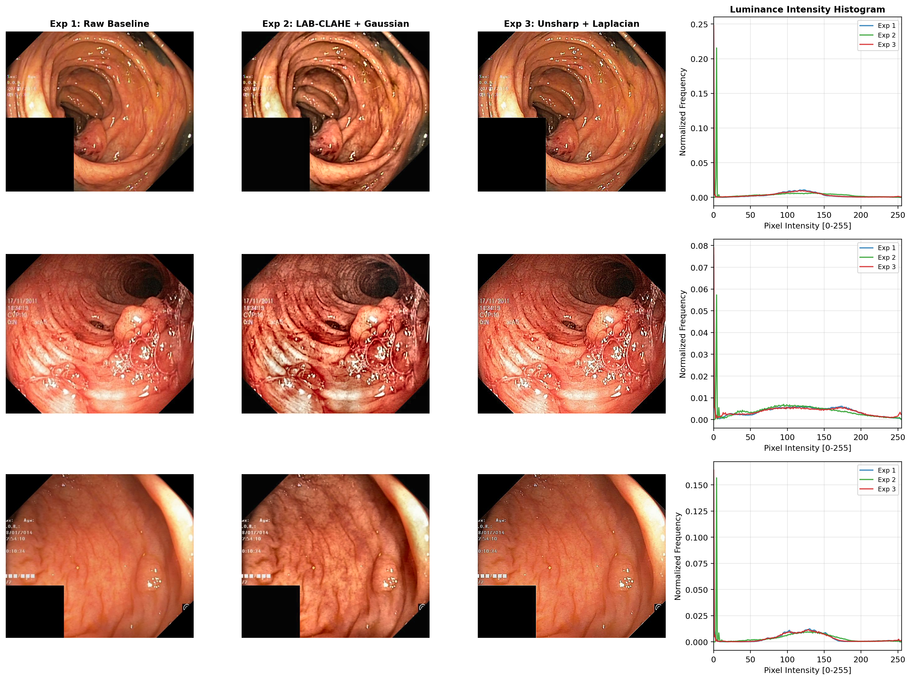
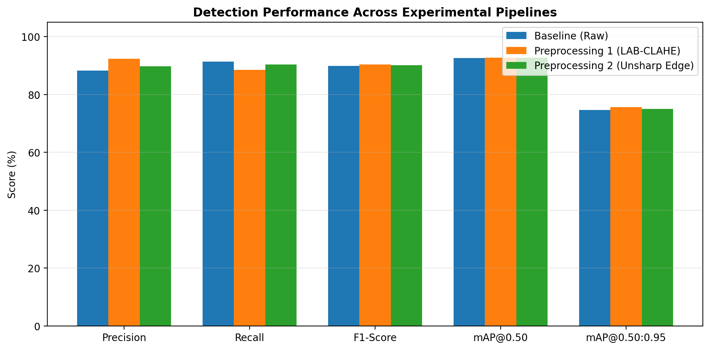
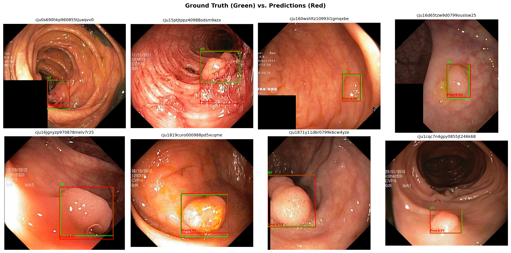
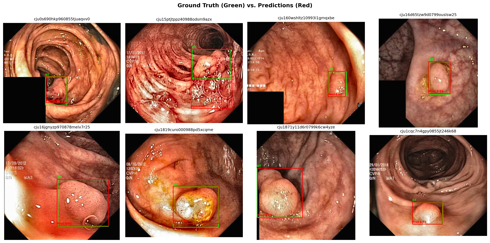
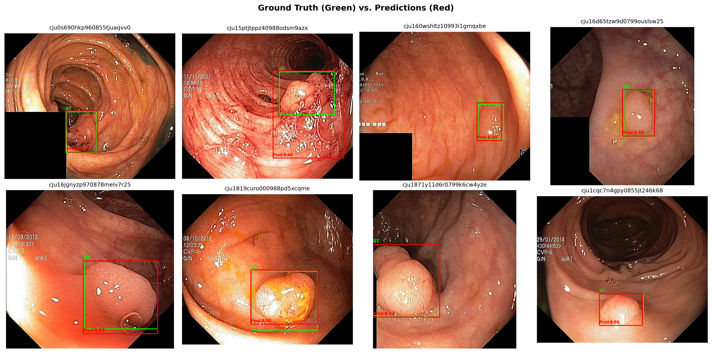

# Colonoscopy Polyp Detection: Classical Enhancement & Deep Learning CADe Benchmark

[](https://www.python.org/)
[](https://github.com/ultralytics/ultralytics)
[](https://modal.com/)
[](https://huggingface.co/Muhammad-Huzzaifa/colonoscopy-polyp-detection)
[](https://datasets.simula.no/kvasir-seg/)

An end-to-end, configuration-driven Computer-Aided Detection (**CADe**) framework for real-time localization of colorectal polyps in optical colonoscopy frames. This repository systematically benchmarks how classical spatial and frequency/luminance preprocessing techniques impact single-stage anchor-free object detectors (`YOLOv8m`) on the **Kvasir-SEG** dataset.

> **Lightweight Repo Architecture:** All experimental metrics, training curves, confusion matrices, and qualitative evaluations are version-controlled inside [`results/`](./results), while heavy model checkpoints (`best.pt`) are automatically pushed to the [**Hugging Face Model Hub**](https://huggingface.co/Muhammad-Huzzaifa/colonoscopy-polyp-detection).

---

## Key Highlights & Experimental Scope

Colorectal cancer (CRC) predominantly arises from adenomatous polyps, yet clinical colonoscopy suffers from a **15%–30% miss rate** due to uneven single-point LED illumination, mucosal fold shadows, wet specular glare, and faint boundaries on flat/sessile lesions. 

This repository evaluates three controlled experimental pipelines on an identical `80% / 10% / 10%` (`seed=42`) split of **Kvasir-SEG**:

1. **Experiment 1 — Baseline (`exp1_baseline`):** Reproduction of the base paper architecture (**YOLOv8m** with `CSPDarknet53` + `C2f` backbone, `PAN-FPN` neck, and decoupled `CIoU + DFL` head) trained on raw RGB colonoscopy frames.
2. **Experiment 2 — Luminance Contrast Normalization (`exp2_preproc1`):** Applies $3 \times 3$ **Gaussian Low-Pass Smoothing** ($\sigma = 0.5$) followed by **Contrast Limited Adaptive Histogram Equalization (CLAHE)** strictly on the Luminance ($L$) channel in perceptual **CIE LAB** space (`clipLimit=2.0`, `tileGridSize=8x8`) to illuminate dark haustral folds without distorting vascular chrominance ($a, b$).
3. **Experiment 3 — Boundary & Edge Sharpening (`exp3_preproc2`):** Combines $5 \times 5$ **Gaussian Unsharp Masking** ($k = 1.2$, $\sigma = 1.2$) with second-order **Laplacian High-Boost Filtering** ($\nabla^2 L$, $w = 0.15$) to accentuate subtle mucosal elevation contours of flat and sessile polyps.



---

## Benchmark Results (Held-Out Test Split)

All models were trained for 80 epochs (`batch_size=16`, `imgsz=640`, `AdamW`, Cosine Annealing LR) on an **NVIDIA A10G (24 GB VRAM)** GPU via Modal Serverless infrastructure.

| Metric | Exp 1: Baseline (Raw RGB) | Exp 2: LAB-CLAHE + Gaussian | Exp 3: Unsharp + Laplacian | Best Delta vs. Baseline |
| :--- | :---: | :---: | :---: | :---: |
| **Precision** | 88.29% | **92.28%** | 89.69% | **+3.99%** (Exp 2) |
| **Recall** | **91.35%** | 88.46% | 90.38% | Baseline |
| **F1-Score** | 89.79% | **90.33%** | 90.04% | **+0.54%** (Exp 2) |
| **mAP@0.50** | 92.63% | **92.69%** | 92.68% | **+0.06%** (Exp 2) |
| **mAP@0.50:0.95** | 74.57% | **75.67%** | 75.02% | **+1.10%** (Exp 2) |
| **Inference Latency** | 7.56 ms (~132 FPS) | **6.16 ms (~162 FPS)** | 6.44 ms (~155 FPS) | **-1.40 ms** (Exp 2) |
| **Pretrained Weights** | [HF Hub (`exp1`)](https://huggingface.co/Muhammad-Huzzaifa/colonoscopy-polyp-detection/tree/main/exp1_baseline) | [HF Hub (`exp2`)](https://huggingface.co/Muhammad-Huzzaifa/colonoscopy-polyp-detection/tree/main/exp2_preproc1) | [HF Hub (`exp3`)](https://huggingface.co/Muhammad-Huzzaifa/colonoscopy-polyp-detection/tree/main/exp3_preproc2) | — |



### Key Findings
* **Precision & Localization Boost via LAB-CLAHE:** Decoupling luminance in CIE LAB space and normalizing local contrast reduced false-positive detections on shadowed folds, boosting **Precision by +3.99%** ($88.29\% \rightarrow 92.28\%$) and strict multi-IoU bounding-box tightness (**mAP@0.50:0.95**) by **+1.10%** ($74.57\% \rightarrow 75.67\%$).
* **Balanced Edge Enhancement:** Spatial Unsharp Masking + Laplacian filtering achieved the most balanced Precision/Recall profile (**89.69% Precision**, **90.38% Recall**, **90.04% F1**) by sharpening faint sessile polyp boundaries.
* **Qualitative Performance:**

| Exp 1: Baseline Predictions | Exp 2: LAB-CLAHE Predictions | Exp 3: Unsharp-Laplacian Predictions |
| :---: | :---: | :---: |
|  |  |  |

---

## Repository Structure

```text
colonoscopy-polyp-detection/
├── configs/
│   ├── exp1_baseline.yaml
│   ├── exp2_preproc1.yaml
│   └── exp3_preproc2.yaml
├── src/
│   ├── __init__.py
│   ├── prepare_data.py
│   ├── preprocessing.py
│   ├── models.py
│   ├── evaluate.py
│   └── hf_utils.py
├── results/
│   ├── dataset_stats/
│   ├── exp1_baseline/
│   ├── exp2_preproc1/
│   ├── exp3_preproc2/
│   └── comparison/
├── train.py
├── train_modal.py
├── Makefile
├── requirements.txt
└── .env.example